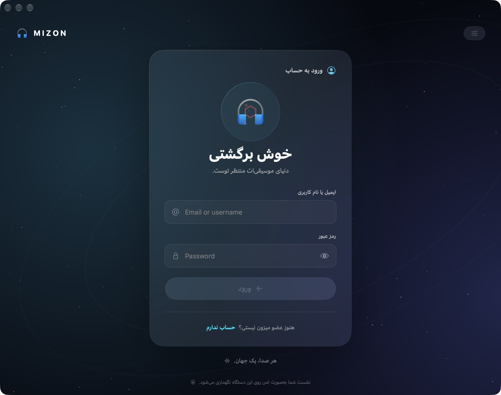

# Mizon.Apple

اپلیکیشن نیتیو **Mizon** برای مک، آیفون و اپل واچ، با SwiftUI و Liquid Glass واقعی اپل. این مرحله بر **صفحهٔ ورود مک** تمرکز دارد و از پکیج [Mizon.API.Swift](https://github.com/Shahesmaeili/Mizon.API.Swift) استفاده می‌کند.



## اجرا روی مک

پروژهٔ `Mizon.xcodeproj` را در Xcode 27 یا جدیدتر باز کنید. Scheme **Mizon** و مقصد **My Mac** را انتخاب و Run کنید. برای اجرای روی دستگاه شخصی، Signing Team خودتان را انتخاب کنید.

ساخت یک بستهٔ محلی بدون وابستگی به ابزارهای جانبی:

```sh
./Scripts/build-macos.sh
open build/Mizon.app
```

Swift 6.4+ و macOS 26+ لازم است. SDKهای iOS و watchOS در Xcode ارائه می‌شوند. خروجی محلی ad-hoc امضا می‌شود؛ انتشار خارج از دستگاه توسعه به امضای توسعه‌دهنده و فرایند معمول توزیع اپل نیاز دارد.

## ورود

- ایمیل یا نام کاربری و رمز عبور، مطابق کلاینت ویندوز.
- تشخیص ایمیل دقیقاً با الگوی `LoginPageViewModel.IsEmail` ویندوز؛ فاصلهٔ ابتدا و انتهای شناسه حذف می‌شود و رمز دست‌نخورده می‌ماند.
- درخواست واقعی `LoginOperation` از SDK، با gzip و قرارداد پاسخ اصلی.
- دکمهٔ ورود تا تکمیل فیلدها غیرفعال است؛ هنگام ارسال، فرم قفل می‌شود و حالت انتظار و لغو درخواست نمایش داده می‌شود.
- نمایش/پنهان‌کردن رمز، ارسال با Enter، جابه‌جایی فوکوس و خطای فارسی اتصال.
- توکن‌های نشست فقط در **Keychain همین دستگاه** و جداگانه برای هر آدرس سرویس ذخیره می‌شوند. رمز عبور ذخیره یا لاگ نمی‌شود و پس از ورود موفق از فرم پاک می‌شود.

پیش‌فرض سرور مانند مرجع `https://localhost:5128` است. از دکمهٔ تنظیمات بالای پنجره یا منوی **Mizon → Settings** آدرس HTTPS سرویس واقعی خودتان را وارد کنید. آیفون و ساعت به آدرس قابل‌دسترسی از همان دستگاه نیاز دارند؛ `localhost` به خود دستگاه اشاره می‌کند. اعتبارسنجی TLS غیرفعال نشده است.

آدرس بک‌اند فعال یا حساب آزمایشی در اختیار پروژه نیست؛ ورود موفق از طریق پاسخ‌های کنترل‌شدهٔ تست بررسی شده و خطای اتصال واقعی به localhost در اپ مک نیز آزمایش شده است. آزمون ورود به سرویس زنده همچنان به آدرس و حساب شما نیاز دارد.

## طراحی و مرجع ویندوز

مرجع: [Mizon.Windows](https://github.com/Shahesmaeili/Mizon.Windows) در کامیت `eb809c142c38c4d6cb88a1d75b83dbd61680c351`، به‌ویژه:

- `Pages/LoginPage.xaml`
- `ViewModels/LoginPageViewModel.cs`
- `Assets/Animation.gif` و لوگوی هدفون

ساختار آشنای ستاره‌ها، کارت مرکزی، فرم ورود و «حساب ندارم» حفظ شده و با متریال `.glassEffect`، دکمه‌های `.glass` / `.glassProminent`، تایپوگرافی سیستم اپل، چیدمان فارسی و فیلدهای چپ‌به‌راست بازطراحی شده است. این خروجی SwiftUI واقعی است؛ وب‌ویو یا ماکاپ تصویری نیست. Reduce Motion انیمیشن‌ها را متوقف می‌کند و Reduce Transparency کارت را به زمینهٔ خوانا تبدیل می‌کند.

## دامنهٔ این مرحله

**پیاده‌سازی شده:** صفحهٔ ورود مک، اتصال به SDK، ذخیرهٔ امن نشست، وضعیت موفقیت و خطا، تنظیمات سرویس و تست‌ها.

**زیرساخت پلتفرم‌ها:** Target مشترک **Mizon** برای macOS/iOS و Target مستقل **MizonWatch** برای watchOS. نمای ساعت فشرده است؛ بیلد هر سه Target بررسی شده، اما پرداخت بصری و آزمون دستگاه آیفون و ساعت به مراحل بعد تعلق دارد.

ثبت‌نام و صفحهٔ اصلی در این مرحله ساخته نشده‌اند. SDK مرجع endpoint ثبت‌نام ندارد. لینک «حساب ندارم» این محدودیت را روشن بیان می‌کند. پس از ورود، تأیید نشست نمایش داده می‌شود؛ «بازگشت به ورود» فقط نشست همین دستگاه را پاک می‌کند و ادعای خروج از تمام دستگاه‌ها ندارد.

## ساختار

```text
App/                         Native Xcode entry points, app icon and bundle metadata
Sources/MizonAppleCore/
  Models/                    Backend configuration, session and errors
  Services/                  SDK authentication and Keychain session store
  ViewModels/                Observable login state
Sources/MizonAppleUI/
  Pages/                     Login, server settings and compact watch view
  Components/                Native glass surfaces and animated branding
  Resources/                 Referenced Windows brand assets
Tests/                       Login state and real SDK contract integration tests
Scripts/                     Build and platform validation
Documentation/               Scope, QA and asset provenance
Mizon.xcodeproj/              Shared macOS/iOS and watchOS schemes
```

## تست و بیلد

```sh
swift test
./Scripts/validate-apple.sh

xcodebuild -project Mizon.xcodeproj -scheme Mizon \
  -destination 'platform=macOS' CODE_SIGNING_ALLOWED=NO build
xcodebuild -project Mizon.xcodeproj -scheme Mizon \
  -destination 'generic/platform=iOS' CODE_SIGNING_ALLOWED=NO build
xcodebuild -project Mizon.xcodeproj -scheme MizonWatch \
  -destination 'generic/platform=watchOS' CODE_SIGNING_ALLOWED=NO build
```

۱۰ تست واحد و integration برای تشخیص شناسه، اعتبارسنجی سرور، جلوگیری از ارسال دوباره، لغو، پاک‌کردن رمز، پیام خطا، درخواست واقعی SDK و شکست ذخیرهٔ امن وجود دارد. تست‌ها از رمز یا Keychain شخصی استفاده نمی‌کنند. برای جزئیات بررسی دستی، [QA](Documentation/QA.md) را ببینید.

پکیج SDK روی branch `main` تعریف شده و commit حل‌شده در `Package.resolved` ثبت می‌شود. برای دریافت اصلاحات بعدی SDK، در Xcode گزینهٔ **Update to Latest Package Versions** یا `swift package update` را اجرا کنید.
